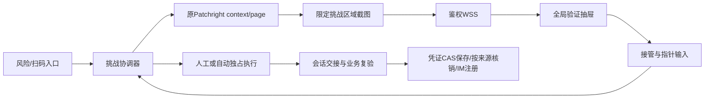

# 挑战人工优先与自动接续方案

版本：v0.3，2026-10-25，Asia/Shanghai。状态：两位独立Agent均完成两轮审核，最终设计PASS，待用户审核。

本文只描述拟议行为、接口与验收要求；没有实现或部署这些能力。当前任务止于方案评审，不进入编码、生产操作或发布。后续参数均为建议默认值，用户批准设计后才进入实现阶段。

## 1. 目标与验收口径

闲鱼要求验证时，在运营控制台显示服务器上真实挑战的画面。用户有5秒优先接管时间；无人接管才执行现有自动求解。人工和自动共用原浏览器会话，最终以业务接口、身份、凭证持久化与连接复验作为恢复依据。

| 编号 | 需求 | 验收结果 |
| --- | --- | --- |
| R01 | 挑战自动出现在页面 | 有权限且在线的页面收到事件后展示验证抽屉，无需跳出控制台或手动复制链接 |
| R02 | 人工优先5秒 | 首帧已显示、交互通道就绪且页面前台可见后，服务器确认并开始5000毫秒窗口 |
| R03 | 接管后独占操作 | 同一会话任意时刻最多一个人工控制者或一个自动执行者；超时和接管竞争只有一个胜者 |
| R04 | 无人接管自动尝试 | 到期后服务端切换自动；无在线用户或渲染失败时有界等待后自动尝试 |
| R05 | 沿用原始会话 | 同一账号、浏览器profile、context、page和服务器网络出口；不把Cookie/Token交给前端 |
| R06 | 真实结果而非假成功 | code=0只显示“验证已通过，正在检查连接”；业务成功后才能显示账号恢复 |
| R07 | 所有入口一致 | 已有账号的IM、只读API、写API触发的风险，以及扫码登录过程中的挑战接入同一仲裁规则 |
| R08 | 故障可恢复 | 刷新、断网、多标签页、进程重启、新登录、删除账号均有明确终止或续接规则 |

适用首期挑战：现有自动求解器支持的滑块，以及同一挑战页内可通过指针完成的点击验证。短信输入、人脸、外部App确认等显示“需要其他验证方式”，引导现有扫码重新授权；不自动填报或绕过。完整远程桌面、任意网页浏览、键盘/剪贴板透传不在首期范围。

## 2. 已核对的项目事实

- `apps/api/src/xianyu-verification-browser.ts`：浏览器是Patchright持久化context，按profile串行并加文件锁；目前在识别挑战后直接调用solver，任务结束关闭page/context。
- `xianyu-browser-mtop.ts`：浏览器原生请求产生自己的挑战，最多允许两次挑战；挑战通过后业务重试与身份检查仍必须执行。不得复用不同网络会话的Node HTTP挑战地址冒充浏览器自己的挑战。
- `xianyu-browser-challenge-handoff.ts`：现有交接等待最长10秒，检查文档完成、在途document/XHR/fetch请求和静默窗口。
- `xianyu-im-service.ts`：API进程是浏览器/IM owner；worker通过既有owner RPC或Redis风险唤醒请求恢复；失败后现有冷却约30秒。现有RPC没有远程画面或人工输入能力。当前native浏览器恢复仍有`upsertCredential`并单独核销Token来源，不能视作已采用完整generation/CAS协议。
- `xianyu-verification-recovery-bridge.ts`：数据库已提交风险是权威，Redis Pub/Sub是唤醒信号；重连扫描持久化风险补偿丢失唤醒。
- `xianyu-qr-login.ts`：扫码确认后也可能转入verification_required；已有loginSession和临时Cookie jar，完成验证后再完成确认登录。
- `apps/web/src/app/account-context.tsx`：账号与通知当前每3秒轮询；`AccountRiskFeedback.tsx`只有风险Toast，不能承担准确的5秒仲裁。
- `xianyu-browser-port.ts`：当前端口已有鼠标输入，但没有截图、截图裁剪和远程交互会话接口，需要专门扩展适配器。
- `realtime-session-access.ts`及现有聊天WS提供会话重检模式；既有账号可见权限不等于manage权限，新通道必须显式检查active manage scope及其到期时间。
- `store-postgres.ts`有基于凭证内容快照的`commitCredentialRefresh`，但它尚未包含本方案账号级generation；QR成功回调`app.ts`的`credentials.save`也需改为受控登录提交。现有CAS方法存在不代表全部写入口已经有保护。

生产排查背景：2026-10-25 20:04有恢复完成记录，20:06再次触发验证；随后既有platform_code:300，也有滑块通过后的CHALLENGE_HANDOFF_TIMEOUT。人工优先只能改变操作方式，不能保证平台放行，也不能替代交接问题排查。

## 3. 总体方案与模块边界

采用“服务器原浏览器画面 + 网页指针输入”的受限远程验证。前端显示图片帧，不嵌入挑战URL/HTML；前端输入由唯一owner转成原page的鼠标动作。截图与输入都在现有Patchright适配层实现，不暴露CDP/VNC端口，不新增第二套浏览器。

| 职责 | 建议模块 | 原则 |
| --- | --- | --- |
| 挑战与操作权状态机 | `verification-coordinator` | 唯一状态转换入口；server time、version与owner generation仲裁 |
| 持久化与原子迁移 | `verification-session-store` | PostgreSQL权威；风险表保持原有职责 |
| 截图与输入适配 | `verification-remote-browser` | 仅引用现有page；区域、坐标、导航、输入序列边界 |
| HTTP/WS传输 | `verification-http`、`verification-realtime` | session鉴权、manage授权、CSRF/Origin、重连与背压 |
| 业务恢复 | 既有IM/read/QR模块 | 复用凭证CAS、身份与风险revision检查，不在UI里核销风险 |
| 全局交互 | Web `features/verification` + App根Provider | 会话列表、抽屉、画面组件、控制器、状态模型分离 |
| 清理与审计 | 既有账号删除/注销 + 会话reconciler | generation失效先于旧浏览器结果落库 |

生产首期仍是单API owner。所有实时接口和浏览器操作均终止于该owner；worker不发送画面、不启动第二个控制器。多API副本需要owner路由和跨进程fencing的独立切片，不在本次隐式开放。

## 4. 用户交互

检测挑战后，无论停留在账号、商品、订单还是消息页，前台页面右侧自动展开“账号安全验证”抽屉，保留当前页面表单和选中账号。PC宽度建议600–720px，移动端使用全屏验证面板；不改变全局当前账号，不覆盖另一个正在操作的验证。

抽屉由四块组成：账号/待添加账号标识、真实挑战画面、状态与倒计时、操作按钮。代码名和profile路径不出现在产品界面。

| 页面状态 | 用户看到的内容与操作 |
| --- | --- |
| 准备中 | “正在加载验证画面”；无5秒倒计时，不接受输入 |
| 人工优先窗口 | “你可先完成验证，5秒后系统自动尝试”；按钮“我来验证”“立即自动尝试” |
| 人工控制 | “由你操作，剩余30秒”；画面接受拖动/点击，按钮“交给系统”；实际接管时才开始30秒 |
| 其他页面控制 | “验证正在另一页面处理”；仅元数据，不再传画面；允许申请接管，需原控制者释放或租约过期 |
| 自动执行 | “系统正在尝试，请稍候”；画面可观看但禁用指针；按钮“自动结束后由我操作” |
| 会话交接/复验 | “验证已提交，正在检查账号与连接”；禁用人工输入，成功之前保留账号风险标记 |
| 成功 | 只有总体风险为空且IM心跳新鲜才显示“账号连接已恢复”；扫码按真实登录结果显示；自动刷新账号数据 |
| 部分完成 | “本次验证已完成，仍有N项待确认”；逐项列出已恢复的IM/只读来源、待核对的原操作和仍失败来源 |
| 失败 | 区分“验证未通过”“验证通过，连接检查未完成”“需要重新授权”；保留“我来重试”“重新扫码授权”入口 |
| 超时/画面不可用 | 显示具体可操作提示；确认已释放人工输入后，按预算进入自动或等待人工处理 |

用户在优先窗口点击“我来验证”，或在画面可操作区域按下鼠标/触屏，都会先向服务端请求接管。服务端ACK后才注入首个pointer-down；hover、滚动页面、移动鼠标和收到图片不算接管。等待ACK时显示“正在接管”，不提前向远端输入。ACK前只保留候选down和本地当前按住状态，不缓存重放整条轨迹：若已经up/cancel、失焦、关闭或组件卸载，ACK后不注入任何down；仍可见时保留已取得的人工权，提示“接管成功，请重新拖动”。若ACK到达时仍按住且down以来≤300ms、位移≤4个服务器CSS像素、frame/geometry仍有效，则从候选down点开始注入并接受后续move；否则要求松开后重新按下。初版触屏也采用相同规则。ACK失败显示实际状态；预约人工仅在request-human被服务端确认后提示“已预约”，不会假报预约成功。

关闭抽屉只隐藏展示：在优先窗口不重置截止时间；在人工模式先弹出“交给系统并关闭 / 继续人工操作”，确认交给系统后服务端释放输入再切换；自动模式可直接收起。退出登录或权限被撤销不出现确认弹窗，立即收回操作权。

同一用户有多个待验证账号时，以就绪时间排序；当前只有一个抽屉画面，其余显示队列徽标。只有真正显示并取得展示租约的会话获得5秒窗口；其他账号不能为等弹窗无限挂起，按其准备超时自动接续。背景页不自动抢焦点，也不请求系统通知权限。

### 4.1 QR界面与显式人工重试

启用本特性时，QR响应新增`verificationSessionId`、`verificationPresentation=remote`、`verificationPending=true`；不再返回原始`verificationUrl`，旧“新窗口打开验证链接”和“浏览器已打开请去操作”文案不渲染。`verificationAutoLaunch=true`暂保留为旧轮询兼容标志，并明确只表示服务端仍在处理，不表示用户本机打开了窗口；新controller以verificationPending/verificationSessionId判断继续观察。未启用的账号沿用旧响应；回退前先清理新会话，后端恢复旧契约与旧前端成套发布，不支持混用半套UI。

QR弹窗出现挑战时，其内容区切换为同一VerificationPanel，暂停二维码展示；全局抽屉只提供入口提示，不再叠第二个modal。该Panel实际可见且未被其他modal覆盖才ACK。关闭验证面板只收起扫码弹窗，QR流程继续后台处理并保留全局“查看验证”入口；显式“取消此次登录”才取消QR和挑战。二维码刷新先取消旧generation，重新展示新二维码。重新打开按当前快照恢复，不能重置窗口。到期/失败时显示真实状态；登录成功进入连接中，避免把其与IM在线合并。

“我来重试”统一发送`retry(mode=manual_only)`，这个按钮保证本轮不自动接续。终态/无活动会话创建manual_only意图的新任务，新鲜画面ACK并确认人工接管后直接进入30秒human_active，不再要求用户赶5秒；展示仍受8秒上限，未确认则本轮终止并保留待人工。活动会话为human_active时回原画面且不续期；preparing/priority_wait时CAS改为manual_only等待人工确认；auto_active时变为明确人工预约；settling/handoff/rechecking时返回“正在确认结果”，先完成原轮，不平行新建。明确过期或取消的QR要求新扫码，不复活旧二维码。所有路径幂等。

manual_only下用户关闭、转后台、超时或断线无法恢复时保留风险，不自动运行；只有明确按“交给系统”且自动预算允许时才能转换为manual_then_auto。普通首次检测默认为manual_then_auto，遵循5秒规则。自动预约被接受后，当前attempt若失败则先显示新鲜画面并要求5秒内确认人工；未确认时按原模式/预算继续或等待人工，预约本身不凭空取得30秒。

## 5. 5秒、30秒及无人在线的精确定义

建议默认值：

| 参数 | 值 | 语义 |
| --- | --- | --- |
| humanPriorityMs | 5000 | 可见首帧与输入WS就绪后，服务端设置唯一priorityDeadline |
| viewerDiscoveryMs | 2000 | 挑战进入可展示状态后发现在线且有manage权限的前台页面；无候选即自动 |
| presentationSetupMs | 8000 | 有候选页但未完成首帧展示确认的最长等待；到期自动并提示画面暂不可用 |
| humanControlMs | 30000 | 人工接管后固定总窗口，鼠标移动不续期；无无限占用 |
| viewerHeartbeatMs / staleMs | 2000 / 6000 | presence只用于候选和可见性；不修改认证会话闲置时间 |
| controlReconnectMs | 3000 | 人工WS断开后的重连宽限；期间自动禁止运行 |
| sessionMaxMs | 300000 | 单次恢复会话总时限，包含人工、自动、交接、业务复验；更短的QR/平台期限优先 |
| autoGesturesPerSession | 3 | 一次会话跨所有挑战页的总自动尝试预算；新地址不重置 |
| challengeGenerationsPerSession | 2 | 保留现有最多两轮新挑战边界，且共享自动预算与会话总期限 |

“可见”由document.visibilityState、抽屉打开、画面已解码且区域尺寸非零与WS连接共同决定；前端发送frameId和pageGeneration的presentation-ack。服务端只接受已发送的新鲜帧ACK，前端不能自定开始时间。前端倒计时用服务端serverTime/deadline校正，仅负责显示，切换由服务端单调时钟驱动。

绝对时间公式：`readyAt`为原page挑战和安全区域首次就绪时刻；`discoveryDeadline=min(readyAt+2000ms, expiresAt)`，`setupDeadline=min(readyAt+8000ms, expiresAt)`。discoveryDeadline前无可用候选则结束发现直接自动；已有候选即允许在原setupDeadline前完成展示，候选出现时间不会再加8秒。`priorityDeadline=min(firstValidAckAt+5000ms, expiresAt)`只设置一次。刷新、reserve转移、候选变化都不得改写三个绝对截止；剩余不足5秒时页面显示实际剩余，平台期限优先。

展示租约TTL=4000ms，持有人每2000ms续租，须前台可见且该Panel处于顶层可操作状态。准备阶段候选按“主动点查看→当前账号页→其他前台页”排序，同级以最早请求的server序号打破平局；CAS只授予一个。隐藏/关闭立即释放，掉线由TTL回收；替补接续沿用setup/priority原deadline。人工模式只有controller所属页面持有展示租约，其他页面不抢占；主动切其他账号需先完成当前人工交接屏障。

展示繁忙不同于浏览器资源排队：浏览器资源可等60秒再生成新鲜挑战；已经生成的挑战若该用户正在处理另一账号，只能在readyAt起8秒内获得空闲展示位，否则自动（manual_only则待人工）。队列明确显示“其他验证处理中，本账号最迟X秒后自动尝试”；不能同时承诺每个并发挑战都有5秒实际人工机会。用户点击队列切换时也先安全释放当前控制，不立即抢断手势。这项取舍列入最终用户审核。

首次ACK成功后不会因刷新、隐藏再显示、多标签页或重连重新赠送5秒。无候选和渲染失败分别按2秒/8秒策略退回自动，不能累加无限等待。人工开始后30秒不受5秒计时影响。人工页面切到后台会释放远端按键并进入最多3秒重连/恢复宽限；恢复可见且重新确认控制权后继续原30秒窗口，否则交给自动。

5秒临界点以owner串行命令队列中的CAS和截止时间为准：服务端处理接管时必须now < priorityDeadline；到期任务和接管只能有一个成功。网络延迟造成接管晚到时解释结果，不回放迟到的输入，也不回滚已经开始的自动动作。

## 6. 会话状态机与互斥

业务状态与操作权分别存储，避免把“有人查看”当成“人工已控制”。

业务状态：`preparing → priority_wait → human_active / auto_active → settling / handoff → rechecking → succeeded / completed_partial`；终态还包括`failed`、`expired`、`cancelled`。无前台/展示失败时，manual_then_auto可由preparing进入auto_active，manual_only终止并待人工。settling表示已禁止新输入、正在等待最后一次作答的明确结果，不表示正在自动执行。

| 转换 | 条件与副作用 |
| --- | --- |
| preparing → priority_wait | 原挑战页已准备、展示ACK通过；设置唯一5秒deadline和presentation租约 |
| priority_wait → human_active | 合法manage主体接管CAS成功；controlEpoch+1；设置30秒绝对期限 |
| priority_wait → auto_active | 截止/用户选择立即自动；先撤销展示控制，再启动solver |
| human_active → handoff | 同一page当前挑战产生明确成功verdict；撤销输入，等待交接与业务复验 |
| human_active → settling | 用户交接、人工到期、关闭或重连失败；先撤销输入权并释放按键，等待最后答案/导航结果 |
| settling → handoff | 当前generation的成功verdict优先，无论此前退出原因是什么；自动手势为0 |
| settling → auto_active | 有界观察结束、没有未决作答/导航、当前挑战仍稳定可操作且模式/预算允许；否则结束并保持待人工 |
| auto_active → handoff | 当前挑战code=0且success=true；停止自动动作，进入交接 |
| auto_active → human_active | 只能在自动attempt的安全边界，且已经确认无按键、无待执行动作、未进入handoff；用户须在新鲜画面上确认预约，重新授予人工期限但不得突破会话总时限 |
| handoff → rechecking | 交接等待成功；当前generation与凭证版本仍有效 |
| rechecking → succeeded | 本轮所有目标来源均取得适用业务证据并核销；账号总体风险与IM状态另字段返回，不以会话终态代替账号健康 |
| rechecking → completed_partial | 安全探针或部分来源已验证，但有写/未知/其他来源待核对；风险保留并列出后续动作 |
| 任意非终态 → cancelled | 账号删除/停用、凭证撤销、新登录替换、QR取消、权限变化导致会话失去合法恢复主体 |
| 任意非终态 → expired | 最短有效期或会话总期限到达；清理浏览器，保留风险 |

同一账号仅一个活动恢复会话（不按source重复创建）；各source绑定其episode/revision。新风险加入协调器，旧结果只能核销开始时绑定且版本匹配的来源。已有账号扫码重新登录先递增credentialGeneration并取消旧恢复，再由扫码链路接管profile。新账号使用loginSessionId作为subject；成功前不创建“已连接”账号。

owner的actor队列只串行化短状态转换、CAS结果接纳和动作准入，不在队列内await整个solver、截图、网络响应或数据库长任务。长任务在外部运行，携带session/version/generation回入actor；失效结果直接丢弃。solver须改为可分段派发，每次mouse move/down/up/wheel真正发送前都检查owner单调时钟lease、controlEpoch、当前state及最短绝对deadline。不是只在一整条拖动或一次重试前检查。认证/撤权/取消能在两次动作之间进入仲裁。

人工退出先作输入释放屏障：不再准入旧epoch新命令，3秒内完成已派发动作与强制up确认；失败即关闭context并停止本轮，未确认关闭前不再自动。释放成功后进入settling：观察当前challenge generation的作答请求、verdict和导航，最长`min(10秒, session/QR剩余时间)`，这10秒属于300秒总限但不占重新授予的人工窗口。已有成功或观察中成功立即转handoff；明确失败且无未决请求、当前挑战稳定至少500ms才允许自动。观察期到但仍有未决请求/导航或结果不明则failed(outcome_unknown)，保留风险，不自动猜测重试。无在途作答且挑战保持可操作也需静默500ms；跳转和旧generation的迟到结果不能驱动新challenge。code=0从human_active/settling/auto_active进入handoff只有一次，开始下一自动动作前再次核对最新verdict。

自动执行中用户预约不会立刻中断正在拖动的手势；当前attempt的明确结果和settling完成后才安全切换。若已通过则复验优先；未通过才展示人工确认。任何无法证明手势/答案已经结束的状态，都不在原page同时起第二个执行者。

## 7. 原会话画面与输入协议

截图从原page的viewport裁剪“验证区域+必要提示”，不抓浏览器工具栏或完整桌面，不保存图片。无法安全定位区域时不传全页，显示画面不可用并按自动退路处理；未知验证类型进入人工待处理提示。验证成功导航后立即停止截图，登录和聊天页面不继续推流。

画面通过WSS二进制JPEG帧发送，初始目标：闲置2fps、操作期间8–12fps；每帧≤250KB、每会话≤2MB/s，上限为验收约束而非现有性能承诺。只保留最新未发送帧，socket缓冲>1MB丢旧帧并降帧；控制/状态信息具有优先级。每个subject最多一个画面消费者，其他有权限页面只看元数据。

帧元数据：sessionId、frameId、pageGeneration、geometryRevision、captureTime、viewport尺寸、裁剪区域、图片尺寸。前端输入：commandId、controlEpoch、pageGeneration、geometryRevision、frameId、sequence、type、归一化x/y。服务端完成letterbox反算、裁剪坐标映射与边界检查；裁剪外、旧page、旧几何、过期控制权和乱序输入拒绝。前端缩放只改变显示比例，不修改服务器viewport。

首期输入仅left pointer-down/move/up以及必要的挑战区域内点击；不开放任意键盘、文件上传、下载、剪贴板、地址导航或DOM执行。每个控制WS最多60条move/s，合并连续move；down/up不丢弃。最多一个按下指针；pointercancel、lostcapture、失焦、断连和epoch变化都触发远端up；同一commandId只执行一次。移动端touch转统一pointer并设置局部touch-action，页面其他区域仍可滚动。

输入仅接受当前挑战页且只在human_active有效；任何非预期导航先递增pageGeneration、禁用输入与截帧，再重新判定状态。新挑战会重置几何并更新画面，但本次会话已消耗的人工优先窗口、自动次数和总期限不重置。

帧防泄露必须由新的Patchright远程适配契约实现，不能假设现有browser-port已支持：监听顶层/相关iframe导航和DOM挑战容器替换，每次捕获绑定pageGeneration、streamEpoch、geometryRevision、挑战类型、容器标识及允许的顶层/iframe URL；在capture前、capture完成后、实际发送前分别重检。任一变化立刻递增streamEpoch，丢弃在途截图及所有待发帧，通知客户端清空画面；不得把旧generation标签贴在新页面像素上发送。相同origin的SPA替换、跨域iframe内部导航也必须触发失效。容器不能明确验证时闭锁停流。popup立即关闭并记录静态原因；download取消；dialog按预设拒绝并停止输入，不把其变成任意远程桌面。后台图像任务不得阻塞actor，客户端更新state后清空旧图片而不是保持可误操作的上一帧。

## 8. 持久化、并发和故障恢复

建议新增`accounts.verification_sessions`、`accounts.verification_session_events`、`accounts.verification_account_claims`、`accounts.verification_budget_attempts`，并在账号增加`credential_generation bigint NOT NULL DEFAULT 1`及受控登录reservation字段。命名/迁移编号在实施时按当时main分配，本文不创建迁移。

sessions核心字段：id；subjectKind(account/login_session)；accountId或loginSessionId二选一；status；ownerInstanceId、ownerGeneration、ownerHeartbeatAt；stateVersion；challengeGeneration；credentialGeneration；riskBindings（source/episode/revision）；priorityConsumed、priorityDeadline；controlEpoch、controllerAdminId、controllerSessionId；humanDeadline、controlReconnectDeadline；autoAttemptsUsed；expiresAt；failureStage/code；createdAt/updatedAt。挑战签名URL、Cookie、Token和frame正文不入这些表。

数据约束：每subject一个非终态会话的partial unique index；subject外键、二选一CHECK；枚举CHECK；非负计数；状态迁移采用expected stateVersion + ownerGeneration的条件UPDATE；对应subject有效性在同一事务检查。account/login删除流程先取消活动会话并释放引用，再按既有purge顺序删除。审计事件追加式，包含server序号与前后version；事务内写状态和事件，Redis只在提交后唤醒。

人工控制令牌绑定controllerSessionId+clientInstanceId+WS connectionId，controlEpoch每次授予/失效递增。唯一presentation租约决定哪个页面收到画面；另一标签页不能凭同一登录Cookie发送输入。刷新后用原clientInstanceId和重新鉴权申请重连，旧连接epoch立刻失效；超过3秒则不恢复人工权。租约身份不等同授权，所有接口仍需重新验证。

owner每2秒心跳，成功持久化后才更新本地最长6秒的单调lease；动作实际派发前检查lease已过期则无条件停止，即使心跳定时器尚未恢复。事件循环暂停7秒后恢复的第一条solver continuation也不得派发动作。首期采用保守单owner策略：停顿超过6秒后旧会话终止、尽力释放输入并关闭context，不自动复活；无第二owner启动直到旧API及浏览器进程确认退出。已派发动作不能靠CAS撤回，必须经过3秒排空/关闭屏障；不能确认关闭则由部署/进程外看护停止owner容器并验证其浏览器子进程退出，未确认前系统保持不执行。

首期进程重启不复用旧page/按键/画面，不恢复human_active，旧会话记owner_lost并终结；清理浏览器后由持久化风险重新调度新会话。新会话继承稳定budgetSubject预算和熔断，不能靠重启绕过。新owner仅在确认旧浏览器进程退出且profile锁可取得后启动；不能确认则保持等待并报警，拒绝双写。

数据库故障时控制权和风险核销fail closed：停止输入与自动动作，释放按键；结果不能安全落库则保留风险并终止，不继续“先成功后补写”。Redis故障不丢状态，owner以数据库扫描恢复可执行任务。WS采用唯一无缝时序：先注册owner事件缓冲→从PG读取snapshot和highWatermark→发送snapshot→按eventSequence冲刷缓冲中高于highWatermark的事件→进入live。持久化events有每会话单调eventSequence，和状态变更同事务写入；列表流使用独立全局cursor。缓冲溢出/gap时重做该握手，不能凭Pub/Sub补历史。GET只供初始化/诊断，不能被当作WS订阅屏障；取消/撤权事件还会直接关流，所有迟到输入仍由服务端拒绝。

### 8.1 凭证generation权威与提交协议

`accounts.accounts.credential_generation`是账号级权威，不以verification_sessions中的副本充当权威。显式新登录占用、手动导入凭证、撤销/停用/删除都在账号事务中递增；普通自动续期不递增generation，但仍对credential id/updatedAt/内容快照做CAS。临时QR还绑定既有loginSession及其generation，generation未验证不得写账号凭证。

新增统一受控提交服务（拟名`commitAccountCredential`），按命令mode分别校验fence；共同要求事务内锁账号、未deletion_started/disabled、expected账号generation、适用凭证快照CAS、主体身份和该模式规定的当前授权，原子保存完整Cookie/Token/deviceId。不能让普通请求为了刷新Cookie而必须创建verification会话：

| 命令模式 | 专属必需fence |
| --- | --- |
| recovery | 活动verification会话及ownerGeneration、有效执行账号claim、expected凭证快照、合法恢复主体的当前manage授权 |
| login | 有效login reservation、QR/loginSession generation、已完成rebind释放证明、创建者授权/已有账号active manage；只有此模式可正式插入新凭证 |
| import | 已认证主体active manage、显式导入命令幂等键、事务内递增generation并使旧任务失效；先验证导入内容身份，不要求存在verification会话；受控首次导入可通过独占import reservation插入凭证 |
| normal_refresh | 当前业务既定的有效账号授权、请求开始时generation和凭证快照；没有排他login/import/recovery写占用；不要求verification会话、owner或claim；沿用原业务权限，不把普通只读调用强制升级为manage |
| revoke/disable/delete、mark_verified | 前者在其授权事务内递增generation并失效所有旧任务；后者只有同generation、凭证快照及真实校验证据仍匹配才更新，不能把revoked改回active |

后台自动恢复使用合法账号恢复主体的当前授权；人工控制者退出只撤销其控制，不借其旧认证继续输入。自动流程失去所有合法恢复主体时终止。普通refresh不能在无凭证/已撤销状态插入复活凭证；登录/导入的受控reservation是明确例外。

必须纳入同一fence的写入口：IM native及fallback的upsertCredential分支、QR onSuccess的credentials.save、read recovery已有commitCredentialRefresh、周期/按需MTOP Cookie与Token更新、手动导入、撤销和markVerified。逐个列清调用点与验收，防止旧快照通过旁路重新写入。当前`upsertCredential`不作为恢复公开写API继续使用；credentials.save改为受控登录/导入命令。新生成凭证保存与验证结果记录原子完成，风险核销另按适用业务证据和source revision CAS，不能仅保存Token就清im_listener风险。

凭证保存后IM注册失败：保留已保存的同generation凭证，不伪造在线或清连接风险；记录部分结果并保留/建立正确来源风险。新登录已递增generation后，所有旧浏览器回调、旧MTOP保存和markVerified都必须CAS失败，不能重新激活旧身份。

### 8.2 临时QR解析到已有账号的受控绑定

subject保持loginSession不变，不把活动page迁到第二个subject或复制profile。扫码身份解析后、任何账号凭证保存前进入`rebinding`子阶段：以平台+userId的事务级身份锁解析目标账号；已有账号必须验证创建者当前active manage权限，不因扫到账号而自动补授已有账号权限。新账号在身份锁下原子创建pending账号和创建者manage归属，最终提交失败保持未登录，不产生connected假账号。

所有账号恢复及QR绑定共享`verification_account_claims(account_id PRIMARY KEY, session_id, kind, generation, reservationId, expiresAt)`，它是跨subject执行屏障。两阶段：A事务取得reservation、递增目标credential_generation、使旧account恢复失效，标记rebind pending；事务提交后在外部取消旧任务、关闭旧account context并确认profile释放；B事务再次检查reservation、账号生命周期、临时QR generation/期限/创建者权限和旧context已确认关闭的证明，再原子绑定loginSession.account_id与受控保存凭证。A不能持数据库锁等待浏览器关闭；B失败释放reservation并终止临时恢复，generation不回退。

已有账号同时被两个临时QR识别：第一位成功占用reservation者继续；第二位返回LOGIN_ACCOUNT_BUSY，不覆盖第一位，不擅自递增其reservation。用户可明确取消后再重新扫码。已知accountId的重新扫码在创建时就通过同一reservation协议使旧恢复失效；未知身份的普通扫码页面不能提前阻塞任意账号。QR使用原临时profile完成最后交换并关闭后，才释放claim并幂等启动目标账号的正式IM/profile；不拷贝活动profile文件。账号删除/撤权穿插会使B失败，不能落库。新建pending账号的失败清理沿用账号清理协议和外键顺序，不删除别的登录已成功绑定的账号。

### 8.3 稳定自动预算与执行前预留

budgetSubject分层：已有账号使用accountId；未知身份使用服务端生成且跨刷新/续码保留的loginFlowId，同时扣创建者adminId级自动预算。新开flow仍受相同管理员滚动15分钟上限约束，不能通过重新打开登录规避；QR识别已有账号后还必须满足账号既有预算。合并采用交集/更严格额度：一次自动尝试在flow/admin/account适用的每个bucket均要有额度；已消耗记录通过attemptId关联，绝不通过相加余额或新id补发额度。

budget_attempts记录bucketKind/bucketId、attemptId、verificationSessionId、kind(session/gesture)、reservedAt、dispatchState。每个自动会话开始及每个手势派发前，在同一事务锁定全部适用bucket、按DB now计算滚动窗口并预留额度，唯一(bucket,attemptId,kind)防重；额度不足不派发。15分钟自动会话上限3，单会话手势上限3；先预留后运行，crash/结果未知也计消耗，不退款，不重放旧attemptId。窗口边界为`reservedAt > now()-15min`；保留记录至少24小时再清理，活动会话/reservation未终结不得清理。人工作答不消耗自动手势额度，但不能重置自动额度；身份解析时把当前会话的session reservation幂等关联到账号bucket并检查更严格上限，失败则只允许人工或等待。

## 9. HTTP与实时契约（拟议）

所有JSON沿用现有API envelope、requestId/traceId。所有mutation带现有CSRF头和Idempotency-Key；sessionVersion用于乐观并发。WS只传实时状态、图片和低延迟输入，操作权授予通过HTTP事务确认。

| 接口 | 用途与限制 |
| --- | --- |
| GET `/api/v1/verification-sessions?active=true` | 返回当前管理员有manage权限的账号会话和本人创建的loginSession会话；不返回平台URL |
| GET `/api/v1/verification-sessions/{id}` | snapshot及serverTime、stateVersion、可执行actions、deadline、当前generation |
| POST `.../{id}/presentation` | 申请唯一展示租约；有界有效期；可见首帧ACK在此提交，首次有效ACK才开始5秒 |
| POST `.../{id}/claim` | 原子接管；包含expectedVersion、clientInstanceId、已展示frameId；返回controlEpoch或409当前状态 |
| POST `.../{id}/release` | 当前controller声明交接意图；先进入输入释放与settling，确认答案无未决结果才按模式/预算进入自动 |
| POST `.../{id}/auto` | 优先窗口内用户主动立即自动；预算、权限和generation检查完整 |
| POST `.../{id}/request-human` | 自动执行中预约安全边界接管；不提前授予输入权 |
| POST `/api/v1/verification-sessions/retry` | 带mode=manual_only或manual_then_auto，界面“我来重试”固定manual_only；按§4.1幂等复用或建任务，不创建并行任务 |
| WS `/api/v1/verification-events` | 登录态下按授权过滤会话列表变化与presence；按§8先订阅缓冲再snapshot握手 |
| WS `/api/v1/verification-sessions/{id}/stream` | 验证Origin/session/manage权限/presentation租约；首包snapshot，之后status/frame/input-ack |

presence由事件WS发起，带clientInstanceId和visible；presence不能自报adminId或权限。presentation接口需要两步action=reserve/ack，ack绑定实际stream发送过的frameId，必须在setup deadline内完成。已接管会话的重连使用claim action=resume，限定原controller登录会话和clientInstanceId，原humanDeadline不变。上述action都纳入幂等fingerprint。

状态事件：session.created/updated、presentation.ready、control.changed、challenge.verdict、recheck.started/result、session.finished。包含eventId、sessionId、stateVersion、occurredAt、generation和脱敏payload。客户端只应用更高版本事件；版本跳跃则取snapshot。指针ACK包含commandId/sequence/accepted/reason，不能回显平台请求地址。

会话结果单独返回`executionOutcome`（succeeded/completed_partial/failed等）、`accountHealth`（风险汇总、IM连接/心跳），及`sourceResults[]`（source、状态、原因、nextAction）。source状态为verified、probe_only、requires_user_confirmation、failed或superseded；不得从session succeeded直接推导AccountStatus=connected。事件排序以eventSequence为准；同一stateVersion内的非状态事件也按sequence消费，不因“只应用更高version”被误丢。最后一条snapshot带eventSequence/highWatermark，客户端按sequence检查gap后重新握手。

错误约定：401未登录；403无manage/扫码会话归属不符；404不可见资源；409控制已占用/版本已变化/自动已开始/旧generation；410会话过期或已取消；422坐标/序列非法；429频率或预算限制；503浏览器owner/数据库不可用。403/404细节沿用现有防枚举策略。超时后重复claim/release必须返回已完成结果或当前快照，不二次执行。

## 10. 权限与数据边界

已有账号：必须是有效登录管理员，具有当前账号`scope=manage AND status=active AND expires_at未过期`，账号未删除/停用。不能复用仅检查“任何account scope”的hasAccountScope作为远程控制权限。扫码临时会话：只能由创建该loginSession的有效管理员控制；若已绑定账号，同时检查该账号manage权限。

WS握手严格校验配置允许的Origin和HttpOnly session；不通过query传平台token或长期控制token。状态/画面发送前与每条输入前执行授权检查；可使用最长1秒的授权快照并由撤权事件即时失效，认证/DB检查失败立即停止，验收撤权最迟1秒内生效。WS保活、截图和presence均不延长现有认证闲置期限。

会话流不返回Cookie、accessToken、sign、挑战原始URL、完整HTML或浏览器profile路径。图片只在内存流转，Cache-Control=no-store，无默认录像/HAR；日志与事件不保存指针轨迹或图片。前端Blob/ObjectURL在更新/关闭时释放。前端和服务端均禁止把画面/输入发给其他账号或管理员。

顶层页面导航仅允许预配置的闲鱼验证/业务origin，首期以现有goofish验证域名为基线；外部跳转立即停流并判定重新授权。子资源遵循原挑战加载策略，不把任意资源host等同顶层导航权限；安全区域判定必须考虑跨域iframe。新窗口、下载和浏览器对话框不直接暴露给操作页。生产仅开放既有HTTPS/WSS入口，Nginx增加对应Upgrade路由与限流，无新增公网浏览器调试口。

## 11. 复验、来源隔离与写操作边界

人工和自动共用以下成功链：当前challenge verdict → 完成会话交接 → 原浏览器业务请求 → expected userId/deviceId检查 → 凭证CAS持久化 → 适用业务复验/IM真实注册与新鲜心跳 → 对应风险source/episode/revision条件核销。需要IM证据的来源不能在注册/心跳之前核销。人工页面上的“成功”或用户点“我完成了”不能跳过任何一步。

已有账号IM：取得Token与身份一致、凭证保存成功且IM已connected并收到≤15秒心跳，才显示账号恢复。只读来源：重放中央白名单中原始只读请求，逐source核销；新revision、其他source或写操作风险继续显示，不因一个source成功清空整账号。

写API/未知API触发风险：允许启动挑战和安全探针，原发货、改价、发消息、发布等动作绝不因为验证成功自动重放；用户需回原业务流程按既有幂等/结果核对规则处理。页面明确提示“验证已完成，原操作请核对后重新提交”，不会直接说原业务成功。

| 来源复验结果 | 会话执行结果与界面 | 风险核销及后续证据 |
| --- | --- | --- |
| IM Token/注册/心跳均通过 | 该source verified；无其他风险时账号恢复 | 以相同generation及source/episode/revision CAS核销适用IM风险 |
| 原只读API和身份通过且凭证已保存 | 该source verified；仍有其他来源则部分完成 | 仅核销该来源；不清新revision |
| 写/未知来源仅安全探针通过 | probe_only/requires_user_confirmation，completed_partial；“仍有N项待确认” | 原来源风险保留，没有时间到了自动清除的规则 |
| 用户已核对原写结果并显式重试成功 | 回原业务流程提示该操作实际结果；刷新风险汇总 | 只有该业务服务记录可关联原source、开始时episode/revision、credentialGeneration的明确平台成功证据，才调用条件核销；不是本次挑战自动重放 |
| 原写结果未知/重复提交被幂等账本阻止 | 保留“请核对原操作结果”，不建议盲目重发 | 先按原订单/消息等流程确认既有结果；明确成功可作为同source业务证据，查不到或无法关联则继续保留风险并提供重新授权入口 |
| 未登记来源或仍失败来源 | failed或completed_partial，列出具体未恢复项 | 不允许“已知晓”或安全探针代替核销；重新授权后也需该来源明确成功证据才核销 |

这部分需要在实施中新增受控`recordSourceBusinessEvidence`契约，并接入允许核销的业务成功分支；当前代码不是已有该能力。接口不接受前端自报success；只有真实服务端平台响应、身份/业务结果满足规则且非旧generation才能写证据。不能安全登记的来源显示“该操作仍待验证”，保持风险，不把重新扫码本身当作该写接口成功证据。

QR临时会话：验证画面和操作绑定loginSessionId、QR generation和其expiresAt。成功后仍走completeConfirmedLogin、身份/已有账号匹配和正式凭证保存；QR过期、刷新、新二维码或取消先使旧验证失效。界面区分“登录成功”和“IM正在连接”，新账号只有正式保存后才出现；登录成功不冒充所有连接均恢复。

现有handoff的10秒不简单延长来掩盖问题。增加脱敏诊断：elapsedMs、documentReady、pending请求数量、按document/xhr/fetch类型计数、lastActivityAge、是否发生导航、stage和generation；不记录签名URL或请求正文。若平台code=0但交接失败，显示“验证已通过，连接检查未完成”，保留风险并停止此轮，后续只允许重新受控恢复。

## 12. 重试、失败与资源预算

每会话最多3次自动手势、最多2个挑战generation、最长300秒；失败后同账号自动恢复按30秒、120秒、300秒退避，15分钟滚动窗口最多3个自动会话，之后进入“等待人工处理”。计数覆盖source变化、挑战URL变化、新revision、重启和新会话；严格按§8.3稳定budgetSubject持久化预留，不在内存清零。用户显式人工重试采用manual_only；不能因此清空自动预算或熔断，用户未明确“交给系统”时也不会自动降级到自动。

人工code=300显示失败原因，允许在原30秒内由用户主动重试；不由系统暗中点击重试或刷新。人工超时后先settling屏障，确认无未决结果、manual_then_auto且有预算/有效挑战时才接续，否则保留待处理。code=0之后进入handoff时不能再按人工超时启动自动。

建议初始全局同时运行2个浏览器验证会话，每账号1个；准备/执行资源排队最多60秒，任务在获得资源、生成新鲜挑战后才计展示窗口，不拿旧签名URL排队后直接打开。超时保留风险并报告繁忙；不能为了“自动”突破浏览器资源上限。具体并发数、fps和带宽在隔离环境实测后再确定生产默认。

## 13. 验收矩阵与证据

本轮只审设计；以下是未来实现必须实际执行的验收，不是已完成测试。

| 编号 | 场景与断言 | 层级 |
| --- | --- | --- |
| T01 | 首帧显示前无倒计时；ACK后恰好5000ms；4999/5000/5001ms接管与自动竞争只有一个胜者 | 单元+真实PG并发 |
| T02 | 双标签/双管理员接管、重放claim、迟到输入/epoch、重复command、乱序down/up均不双控 | PG+WS+Chrome |
| T03 | 点击接管及直接拖动均能操作原page；mouse/touch缩放、letterbox、跨域iframe坐标正确；无hover接管 | 前端+真实Chrome E2E |
| T04 | 人工开始后5秒任务不再自动；30秒、后台、断网3秒、取消拖拽均先释放输入后接续 | 状态机+真实Chrome |
| T05 | 无用户2秒/渲染8秒退路；刷新/重连/换页无无限重置；旧frame/generation不可操作 | 集成+E2E |
| T06 | 人工/自动code=0后真实延迟回调、业务身份、PG保存/风险CAS、IM注册与心跳；画面不泄漏后续聊天页 | Chrome+PG/Redis跨层E2E |
| T07 | code=300、交接超时、身份错配、CAS拒绝、DB写失败、IM注册失败均保留正确风险和错误提示 | 回归+集成+E2E |
| T08 | 原始写请求从未重放；只读多source隔离，新revision/新登录/凭证撤销使旧结果无效 | PG并发+请求次数断言 |
| T09 | 账号删除、QR刷新/过期/取消、认证过期、manage撤销与过期、其他账号/租户、伪造Origin均拒绝 | 鉴权集成+E2E |
| T10 | 自动预约人工仅安全边界切换；成功则复验优先；人工释放失败不运行solver；对所有入口验证没有旁路 | 状态机+Chrome |
| T11 | owner崩溃/事件循环暂停/重启、Redis丢唤醒、数据库断开、浏览器遗留锁有明确终止与清理；预算不重置 | 真依赖故障注入 |
| T12 | 2会话并发、慢网、WS背压、不接收图片、输入限频；帧无累计队列，认证/普通API不被拖慢 | 隔离负载+指标 |
| T13 | 3次跨挑战自动预算、2个generation、300秒期限、15分钟熔断，source变化/重启/人工重试不绕过 | 单元+PG |
| T14 | 1440×900、1920×1080、390×844下各交互状态、长账号名、禁用状态、焦点与触控 | 浏览器视觉验收 |
| T15 | QR临时登录与已有账号登录、风险恢复均真正走Coordinator；退出/重新登录后无历史画面和控制权 | 跨层E2E |
| T16 | 人工29.9秒提交/30.4秒成功、release后成功、断网宽限后成功、同tick verdict与timeout；只handoff一次、自动手势为0 | 状态机+Chrome |
| T17 | 同账号IM/read/write混合来源，安全探针、写结果未知、用户显式重试成功；partial提示、风险和写请求次数一致 | 真实API+PG E2E |
| T18 | claim ACK前up/cancel/失焦/卸载/触屏离开及迟到ACK；无孤立down、无历史轨迹回放 | Web+WS+Chrome |
| T19 | reserve竞争/租约转移、两账号展示繁忙、队列点击临界点；绝对2/8/5秒截止与用户提示一致 | PG+多浏览器E2E |
| T20 | QR旧链接不出现、Modal内Panel顶层可见、关闭/重开/取消/过期、旧轮询字段迁移 | Web+真实QR受控E2E |
| T21 | manual_only重试的活动/终态/熔断/断网/重复请求分支；未明确交系统则自动手势为0 | PG+E2E |
| T22 | 旧IM/MTOP/read回调与新扫码/手动导入/撤销并发；所有提交受generation及快照CAS，凭证保存后连接失败仍有风险 | 真实PG并发+Chrome |
| T23 | 两临时QR扫同账号、未知QR扫已有活动恢复账号、rebind A/B间删除/撤权/超时；单reservation、无双profile及旧回调落库 | Chrome+PG |
| T24 | 刷新/新建QR、new flow、身份解析、并发预留、预留后crash均不重置或退还预算，不重复派发attemptId | PG+故障注入 |
| T25 | owner事件循环暂停7秒后恢复，第一条旧continuation不得发鼠标/写凭证；actor不被solver/截图占满 | 真实进程+Chrome |
| T26 | screenshot进行中顶层导航、同origin SPA替换、跨域iframe变化；捕获后/发送前失效帧全丢弃，客户端清画面 | Chrome+内容泄露断言 |
| T27 | snapshot读取与订阅切换时发生auto/cancel/expired；连续eventSequence无丢事件或完整重新握手 | 真PG+WS并发 |
| T28 | 首次上线/开关关闭/回退drain失败；旧owner与浏览器未退出则旧/新自动链都不得启动 | 容器演练 |

复用现有命令基线：`npm run typecheck`、`npm run build`、API的`test:xianyu-slider`、`test:xianyu-im-credentials`、`test:xianyu-post-challenge`、`test:xianyu-verification-recovery`、`test:xianyu-verification-guard:e2e`，Web `npm --workspace apps/web run test`及现有账号反馈E2E。新增协调器/远程流/跨层E2E命令待编码阶段落地，不能把不存在的脚本列为已通过。PG使用拒绝生产连接的隔离测试库；真实平台人工验收单列，不用受控平台响应冒充放行。

性能目标先设门槛：稳定网络下指针ACK p95≤250ms、画面显示延迟p95≤500ms；2个并发验证时普通API p95相对基线增加≤20%，无控制队列/图片内存持续增长。未达门槛则降帧/缩小裁剪并复测，仍不达标不开放人工控制。移动端触控、跨域iframe裁剪和页面导航遮断均为技术验证项，不以代码库存在Patchright为已验证。

## 14. 实现切片、灰度与回退（待用户批准后）

| 切片 | 输出与通过条件 |
| --- | --- |
| S1 原会话受限交互验证 | 隔离Chrome验证截图、触控映射、滑块输入、跨域iframe、成功后立即停流和性能；只读诊断不写生产 |
| S2 协调器与持久化 | PG状态机、账号generation/全凭证写入口fence、QR rebind、唯一活动subject、操作权/epoch、稳定预算预留、取消与owner重启；并发/故障集成通过 |
| S3 前后端完整链 | 全局抽屉、鉴权WS、5秒/30秒、人工/自动接续、已有关联业务复验；真实Chrome→API→PG断言 |
| S4 入口与生命周期闭环 | IM/read/write风险和QR临时会话全部接入；删除、撤权、重连、熔断、通知文案与视觉回归通过 |
| S5 发布准备和真实验收 | 独立评审关闭P0–P2、隔离压测/迁移回滚演练；灰度账号真实人工验证与业务恢复证据 |

每切片先自验再独立审核与复审，不能把尚未通过的切片带入生产。本轮交付不启动S1。

建议特性配置：`manualPriorityEnabled`（总开关）、`manualPriorityAccountAllowlist`（灰度账号）、上述时间/预算/限流参数。配置关闭时：不接受新人工会话，现有会话先完成释放/取消，确认无活动page控制后才恢复既有自动链路；不允许在同一page同时切换两套执行器。部署通过GitHub main和既定Actions统一入口；本次不推送、不部署。

新增表采用加法迁移，默认关闭特性；回退保留表和审计，旧代码不读取新表。先停新会话、清理活动控制与浏览器，再回退业务代码；数据库外键删除顺序在实施时纳入purge回归。无论开关或回退都不修改账号risk为正常，不导入测试Cookie/Token，不删除生产profile或数据库卷。

新增明确部署drain gate，首次启用、关闭特性、升级和回退均适用：暂停worker及owner恢复调度→拒绝新验证/新凭证维护任务→使controlEpoch/streamEpoch失效并停止推流→完成settling或取消并排空3秒输入、关闭全部context→持久化活动会话终结与清理报告→停止旧API/worker并确认owner进程及其浏览器子进程退出→确认profile没有活跃Chromium占用→迁移/切换→启动唯一新owner、再启动worker与调度。任一步失败保持停止并人工处理，不启动旧版自动作为抢救旁路。

可核验报告必须含activeVerificationCount=0、pendingBrowserCommands=0、openContextCount=0、owner容器停止、旧owner browser PID树为空及profile未被活进程占用；不能只看`.xianyu-verification.lock`不存在。统一部署脚本当前已有stop API/worker后再迁移重建的顺序，但尚无上述验证drain协议，需要新增并真实演练；不引入滚动重叠。若回退到不认识generation的新功能前版本，必须在旧进程完全退出后才允许启动；数据库新增字段保留，凭证/风险状态不人工改正常。

## 15. 供用户审核的决策

建议按本文整体批准，重点确认以下产品规则：

1. 可操作画面出现后5秒无人接管才自动；无人在线/画面失败有界等待后直接自动。
2. 接管后30秒独占人工操作；到期先等待已提交答案结果，再按预算交自动；自动手势执行中只允许预约安全边界接管。
3. 首期支持滑块/点击，其他验证类型提示重新授权；失败不会无限自动重试。
4. 当前方案包含扫码登录中尚未正式建号的挑战；成功文案按登录/连接实际阶段区分。
5. 首期采用受限截图流与指针通道，并先验证实用性；不把平台验证链接直接嵌入用户浏览器。
6. 多账号同时挑战而你正在处理另一个时，未获得展示位的账号可能在8秒准备截止后自动尝试；界面提前显示倒计时，不承诺并发每个账号都有人工机会。
7. “我来重试”保证本轮manual_only，未明确交给系统就不自动；“本次验证部分完成”与“账号连接恢复”分别展示。

用户审核是本轮最后一个步骤。审批前只改设计和评审文档；本轮批准也不被解释为已经完成实现、测试或生产放行。
