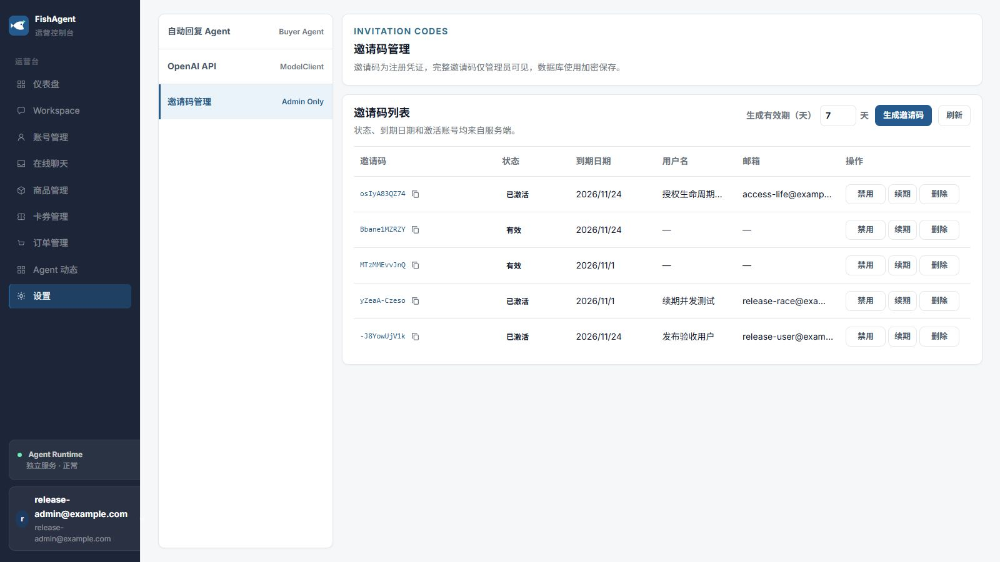
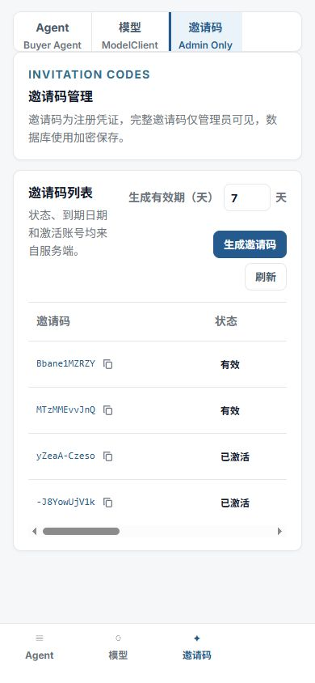

# 已激活用户访问生命周期与表格补充（2026-10-25）

承接[上一轮UI/字段验收](../ui-validation/README.md)，新增用户要求：生成后手动刷新、用户名与邮箱独立列、已激活用户启用/禁用/续期，以及到期或禁用时不能登录或继续操作。

## 实现与独立审核

| 提交 | 作用 | 独立审核 |
| --- | --- | --- |
| eaecfa0 | 刷新按钮、用户名和邮箱六列表格 | status_route_review PASS，浏览器刷新反馈与表头核实 |
| 62fdad6（源0dc2a61） | 后端授权、旧session/WS/Workspace写工具门禁、异步失败持久化 | isolation_review 两轮及并发补充PASS |
| ffad70d | 激活行启停续期、accessStatus与消费事实分离、续期服务端回读 | status_route_review PASS，浏览器联调通过 |
| 4b248a8 | 当前业务401清空旧界面；旧请求取消/代际隔离/CSRF重试隔离 | status_route_review两轮PASS，auth/http及deferred回归通过 |
| edf3d0b | 无闲鱼账号时商品/卡券引导，禁止sentinel请求，账号key重挂 | status_route_review PASS，相关88项及浏览器网络验证通过 |

最终整合：Web 106文件483/483、Web build/typecheck、API build、邀请/隔离/访问/实连WS/旧Run共25/25通过；独立后端另执行Workspace相关80/80、最终并发相关42/42及4个默认管理员smoke（这些集合有重叠，不求和）。API实际输出见api-tests.tap。无新增依赖。迁移068仅增加非唯一used_by部分索引，无新业务字段。

## 授权边界

- 邀请仍按创建的平台管理员created_by隔离，与内部选中的闲鱼账号无关；用户名与邮箱各自一列。操作仍只接受inviteId，由服务端确定对应用户。
- usedAt/usedBy与已消费状态永久保留，accessStatus另算active/disabled/expired，禁用或续期不会让邀请码重新注册。
- 启用只清disabledAt，续期只更新expiresAt。过期但已启用仍拒绝；有效但仍禁用也拒绝。独立撤销、删除状态不因启用而恢复。原管理员不依赖邀请授权，手工无关联的普通user失败关闭。
- 每次密码登录与HTTP会话访问均检查邀请授权；WS升级、每个帧以及1秒无消息心跳均检查，且不刷新session lastSeenAt。授权失效后WS关闭并清理订阅/定时器。
- 已运行Workspace在下一工具、确认、外发发布前仍查授权；入队后失权被持久化为run/step失败，不产生未处理Promise或重建被清除的run。已越过最后鉴权检查并发起的单次外部请求无法撤回；后台自动回复及其他actor共享账号未被全局停用。
- 失权用户仍可用真实session+CSRF退出，退出后的旧cookie不会因启用而复活。业务401/UNAUTHENTICATED清空私有界面并回登录；认证失败、平台401与普通403不会误触发。新登录会取消旧请求，旧响应不退出新用户；旧CSRF失败不借新用户cookie重放写入。

## 实际双浏览器、真实PostgreSQL步骤

内置浏览器使用release-admin@example.com，独立Chrome注册access-life@example.com（昵称“授权生命周期验收”）。均为本地临时测试身份，不是生产账号。

1. 管理员页面生成osIyA83QZ74，Chrome输入邀请码完成注册；刷新后六列显示用户名与邮箱，激活行具备禁用/续期/删除。普通用户没有邀请码管理入口。
2. 为覆盖真实账号操作，用SQL fixture给该用户绑定一个本地闲鱼账号记录（没有真实Cookie），随后通过UI创建卡券“授权有效时可创建”，落库成功。另一用户的“字段验收卡券”没有出现在当前用户列表。
3. 原用户保持卡券编辑器打开，管理员禁用已激活行，原用户提交“禁用后不得创建”被拒绝；SQL只有正常基线卡券，没有禁用后的卡券。重新登录提示“邀请码已禁用，请联系管理员”。
4. 禁用状态下续期30天，列表日期更新但仍已禁用、登录仍拒绝。启用后恢复登录，基线卡券保留。
5. 对且仅对该临时用户关联邀请，用SQL将expires_at设为过去一天以测试无需等待的真实到期边界（不是伪造DOM）。管理员刷新显示已过期；旧业务界面随授权失败被清空，app-viewport数量为0，准备好的写入无法继续。正确密码登录提示“邀请码已到期，请联系管理员续期”。该浏览器阶段没有成功提交到期后的新卡券，实际HTTP写拒绝另由25项接口回归覆盖。
6. 过期状态禁用后再启用，仍已过期且登录拒绝；续期30天后变回已激活并成功登录，仍能读取原卡券。
7. 再禁用有效用户并在旧Chrome点刷新，自动返回登录页，显示会话失效浮层，私有界面数量0。切换release-user@example.com可稳定登录，无旧用户卡券或旧错误残留。
8. 其他用户无闲鱼账号时，商品和卡券页只显示添加/选择账号引导。发现并修复原有__no_active_account__导致PostgreSQL UUID错误的问题；重新加载后用CDP记录稳定切换两页，只有2个Logo资源请求，API请求0、缓冲无截断（empty-account-network.json）。
9. 管理员对该禁用且已激活测试用户执行项目弹窗两步邮箱确认，删除后SQL：用户0、测试闲鱼账号0、基线及禁用/到期禁止卡券0；另一个用户1、另一个卡券1均保留。删除不会跳过二次确认或影响其他用户。

六列表格启停前后的全部表头x/width数组完全一致。移动390×844实测documentWidth=390，表格容器宽320/内部scrollWidth=960，只在表格局部横向滚动；临时视口已恢复。

## 视觉证据

以下是实际页面截图。Chrome登录截图仅展示停留登录页，不将截图中未出现的Toast当视觉证据；具体拒绝消息由同次真实DOM状态和接口测试确认。

图片/网络记录/测试输出哈希见SHA256SUMS.txt。原测试用户已清理；用于观察界面的其他原有临时fixture记录仍在本地专用测试库。未创建生产邀请码或改变生产业务数据。

## 复现与发布

- 本地PostgreSQL测试服务127.0.0.1:55434，test-support为每轮API测试建立/清理独立数据库；浏览器使用另外的临时数据库。
- npm test --workspace apps/web -- --run
- npm run build --workspace apps/web
- npm run build --workspace apps/api
- node --import tsx --test apps/api/scripts/invite-registration/*.test.mjs

主线最终SHA与Actions运行以交付消息为准。仅通过既有main推送触发部署，不手工改远端源码。回滚业务合并提交可恢复原前端/后端；索引可保留或按迁移文件中的DROP INDEX语句移除，不改用户数据。未声称验证真实闲鱼发布、外部模型或后台长期运行。
