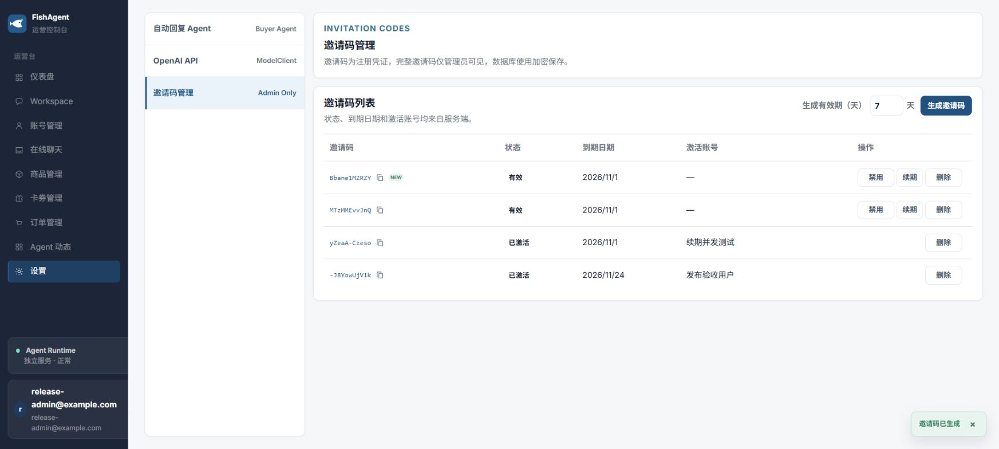
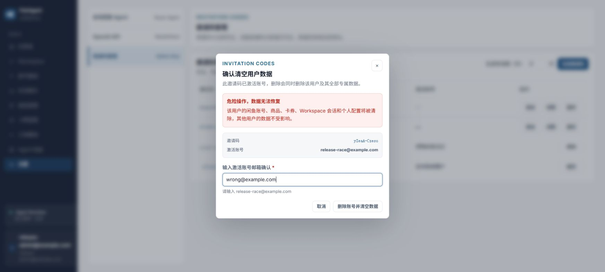
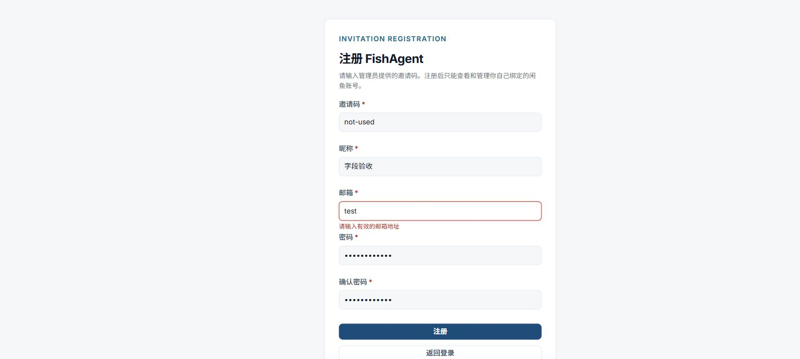
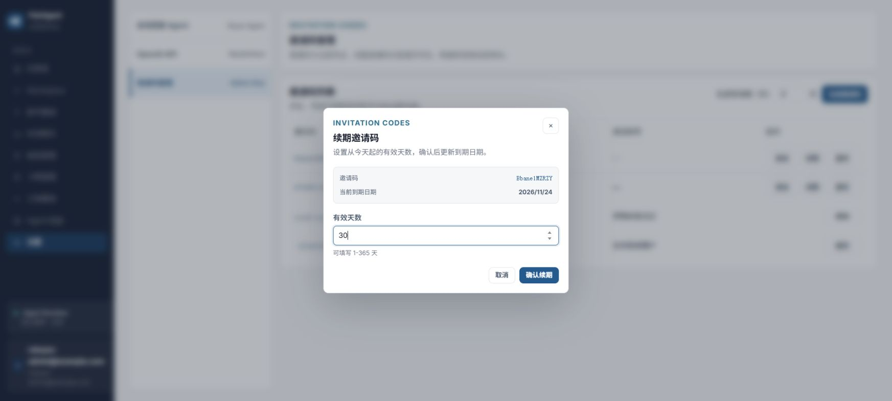

# 邀请码交互与全站字段校验验收（2026-10-25）

本记录截至090f68b；后续已激活用户授权、索引迁移和表格扩展见[访问生命周期验收](../access-lifecycle/README.md)。

本次按独立切片实现、审核后提交。验证基线为 main f979228，业务整合版本 090f68b；截图为实际 Chrome/内置浏览器界面，测试服务连接本机临时 PostgreSQL，未写生产业务数据。

## 交付与审核

| 切片 | 提交 | 独立审核 |
| --- | --- | --- |
| 固定表格列宽、NEW小角标、快捷复制、加载锁与成功Toast | 79594df | status_route_review 两轮 PASS |
| 项目风格删除弹窗、激活用户第二次邮箱确认 | c9d0665 | status_route_review 两轮 PASS |
| 共享Form、Input/TextArea/Select字段校验 | 49611e4（源aae6626） | 两轮审核修复无label DOM与焦点问题后PASS |
| 页面迁移、账号请求竞态隔离、OpenAI折叠字段定位 | 132c13c | 修复晚到保存响应及旧错误首帧后PASS |
| 卡券业务字段和自动化规则校验 | 75d112f（源e37a012） | 修复禁用规则与后端契约不一致后PASS |
| 注册表单反馈预留空间、避免卡片过高 | 090f68b | 独立CSS审核PASS及移动端实测 |

整合独立审核 isolation_review：104文件471项Web测试、Memory/PostgreSQL18项邀请码/隔离回归、typecheck、diff-check均PASS，未发现新增P0-P2问题。Web生产构建通过，保留已有bundle体积提示；此次未增加依赖、API或数据库迁移。

## 浏览器实际执行

- 邀请码：生成后直接进入表格并显示小NEW角标；实测角标约23.3×13px、字号8px。复制在真实Chrome点击后读取该标签剪贴板，内容等于选中测试邀请码。内置浏览器剪贴板桥接及模拟Ctrl+V未提供可靠回读，不以Toast冒充粘贴成功。
- 禁用、启用：API成功后Toast反馈，状态正确刷新；五列表头的x/width在前后完全一致，操作按钮固定槽位。慢网络时生成和表格写操作锁定，防止旧列表覆盖新结果。
- 续期：0天字段红框+就近提示；30/31天成功后关闭弹窗、显示“邀请码已续期”Toast并更新到期日期。最终新测试码到期日2026/11/24。
- 删除：未激活码取消保持行，确认后移除并Toast；激活码先警示清空专属数据，再要求输入激活邮箱；错误内容不发删除，仍在弹窗；实际删除临时release-boundary用户后SQL确认其不存在，release-user仍存在。页面无原生JS确认弹窗。后续截图针对release-race仅输入错误内容并取消，没有删除该用户。
- 注册：无效邮箱显示字段红框、错误文本，noValidate=true、聚焦邮箱；密码不一致贴确认密码字段。正常登录仍能提交到真实API。最终认证卡片错误前后高度均710.04px。移动DOM模拟视口设置390×844（PNG输出309×700像素）下错误底部623.04、下一按钮顶部630.03，无重叠、无横向溢出；视口已恢复。
- 账号：空Cookie、空账号密码按字段提示，不再使用空值Toast；没有向闲鱼提交测试凭证。
- 自动回复：最大循环13出现“不能大于12”并聚焦，改4后成功保存。
- 模型配置：高级探针超时10，折叠后保存会自动展开并聚焦、红框提示最小500；改10000后按Enter执行保存，未触发外部连通性测试。
- 商品：空标题/售价展示对应字段错误；修正后通过UI创建本地“字段校验验收草稿”，12.50元，没有发布到闲鱼。
- 卡券：必填名称与缺少DELIVERY_CONTENT变量分别就近提示；修正后通过UI创建“字段验收卡券”，列表可读。
- 自动化：未启用提醒规则输入0后切换到其他tab再保存，自动回到提醒tab并聚焦错误字段；关闭规则仍能编辑修正，改4320后保存成功Toast。保持原payload语义，不丢弃用户草稿。

## 隔离与校验边界

邀请码属于平台管理员，通过created_by过滤，与管理员内部选中的闲鱼账号无关；普通用户没有管理权限。自动回复/模型配置按闲鱼accountId隔离。控制器立即使旧账号请求epoch失效，并给状态附上accountId/api归属；A→B、A→B→A、晚到失败、旧错误首帧均有deferred回归。

当前生产源码中的原生form已接入共享Form（唯一原生form位于共享实现），使用noValidate防止浏览器气泡；必填、邮箱/URL、长度、数字范围/步长在字段显示。卡券JSON/规格/备注、商品金额和自动化跨tab业务规则也映射到对应字段。API操作结果继续使用全局浮层；局部字段错误不强制变成Toast。Workspace/在线聊天保留原ref、IME、粘贴、requestSubmit发送路径，现有全量测试通过。

这次浏览器为覆盖设置、商品、卡券和自动化字段，使用后台测试seed建立两个本地闲鱼账号记录及一个合成模型配置，未使用真实闲鱼登录态或外部模型Key。未重跑所有外部平台/实时消息E2E，不能把本地字段验收等同真实闲鱼发布、发货或模型服务可用。依赖清理/共享账号保留与多用户权限由18项真实PG/内存API回归验证；本次浏览器删除的测试用户未装填每一种依赖资源。

截图原文件校验值见SHA256SUMS.txt。旧版注册截图被最终紧凑布局覆盖；以本目录为准。

## 视觉证据

## 发布与回滚

主线发布以交付消息中的最终main SHA及Actions运行为准。回滚按依赖逆序撤回上述前端提交，或revert合并提交；无数据库迁移，已在测试数据库中生成的数据不进入生产。主工作区原有session-audit登记修改应保留且不纳入本任务提交。
